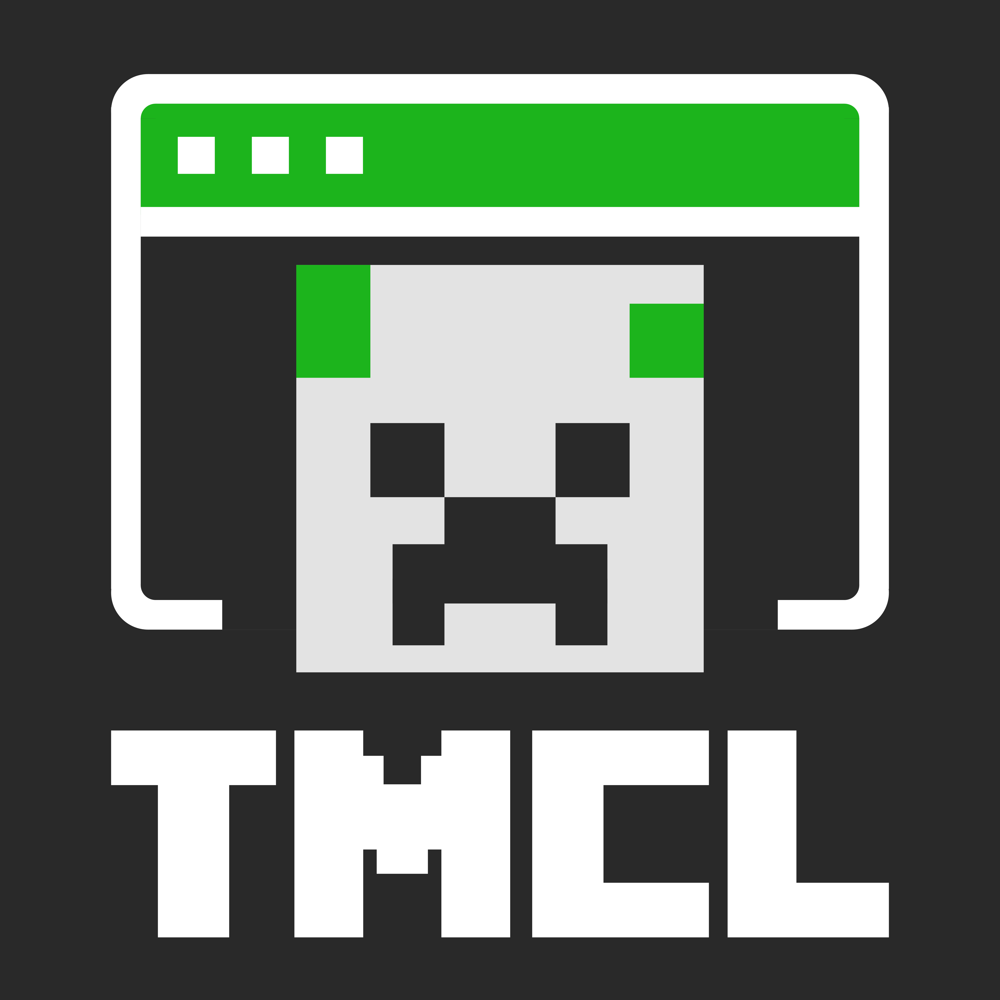

<p align="center">
  
</p>
<h1 align="center">Terminal Minecraft Launcher</h1>

> *[中文版](README.zh.md)*

## About

Terminal Minecraft Launcher (TMCL) is a lightweight, TUI-based Minecraft Java Edition launcher written in C by aleph, primarily targeting GNU/Linux systems.

TMCL is free software released under the GPL-3.0 license — you may freely redistribute and derive from it, provided you retain the original copyright notice. Open source is a means to freedom.

TMCL currently supports installing and launching the following game versions:

- **Vanilla** — all release, snapshot, and ancient versions
- **Fabric** — automatic Loader version matching
- **Forge** — modern 1.13+ and legacy 1.7.10–1.12.2
- **NeoForge** — 1.20.1 and above

TMCL can load mods, but does not include a mod manager, shader/resource pack support, modpack support, or automatic OptiFine installation.

> **Note:** The project is still in early development and not recommended for daily use yet.

## Installation

### Dependencies

- **GCC** (C compiler)
- **ncurses** — terminal UI library
- **cJSON** — JSON parsing library
- **curl** — network downloads
- **pthread** — multi-threading

Debian / Ubuntu:

```bash
sudo apt install gcc libncurses-dev libcjson-dev libcurl4-openssl-dev

Arch Linux:

```bash
sudo pacman -S gcc ncurses cjson curl
```
```

### Build from source

```bash
git clone https://codeberg.org/furii/tmcl.git
cd tmcl
make
make install         # installs to /usr/local/bin/tmcl
make uninstall       # uninstall
```

## Usage

- Keys shown in brackets are shortcuts (e.g. `[C]onfig` means press `c` for settings)
- Vim-style keybindings: `h` / `j` / `k` / `l` to navigate, `Enter` to confirm, `q` to quit

## Contributing

- File an issue on [Codeberg](https://codeberg.org/furii/tmcl) to report bugs or request features
- Fork the repository and submit a Pull Request

## License

This project is released under **GPLv3**, with the following additional term (per GPLv3 Section 7):

- You may not remove the copyright notices displayed by the program (7(b))

## Credits & Contact

- Upstream repository: https://codeberg.org/furii/tmcl — a star is appreciated if you like TMCL
- Please comply with Microsoft's relevant regulations regarding Minecraft — we support genuine copies

### Contributors

Currently the sole contributor to TMCL is **aleph0**, a free software enthusiast from China. When he started this project he was still a high school student with limited programming experience, little domain knowledge, and not much free time — your understanding is appreciated. We welcome your participation as well.

<p align="center"><i>Buy us a coffee — it means a lot to us</i></p>

### Contact

- aleph0 &lt;fossrina@163.com&gt;
