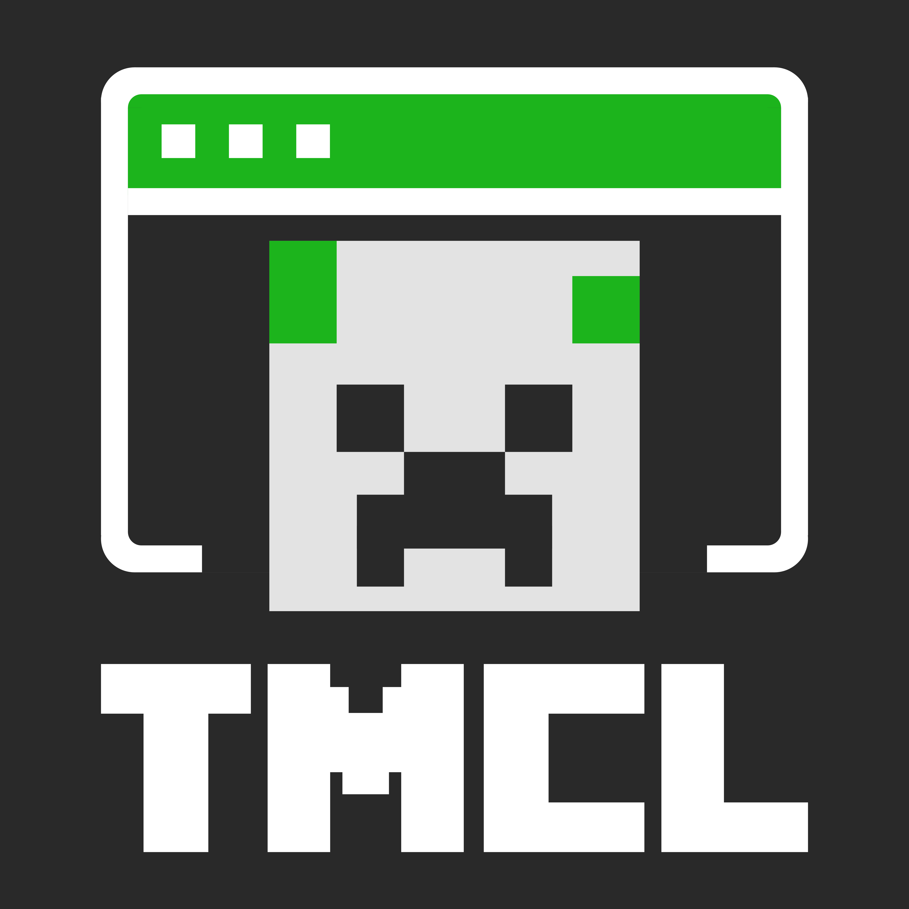

<p align="center">
  
</p>
<h1 align="center">Terminal Minecraft Launcher</h1>

## 介绍

Terminal Minecraft Launcher（TMCL）是一款轻量级、基于 TUI 的 Minecraft Java 版启动器，由 aleph 使用 C 语言开发，主要面向 GNU/Linux 系统。

TMCL 以 GPL-3.0 许可证发布——您可以自由再分发或派生，但须保留原始版权声明。开源是实现自由的一种手段。

TMCL 目前支持安装和启动以下游戏版本：

- **原版**（Vanilla）——所有正式版、快照版及远古版本
- **Fabric** ——自动匹配 Loader 版本
- **Forge** ——1.13+ 新版及 1.7.10–1.12.2 旧版
- **NeoForge** ——1.20.1 及以上

TMCL 可以加载模组，但不包含模组管理器、光影包、资源包、整合包或 OptiFine 自动安装等功能。

> **注意：** 项目仍在早期开发阶段，暂时不推荐日常使用。

## 安装

### 依赖

- **GCC**（C 编译器）
- **ncurses** ——终端 UI 库
- **cJSON** ——JSON 解析库
- **curl** ——网络下载
- **pthread** ——多线程

Debian / Ubuntu:

```bash
sudo apt install gcc libncurses-dev libcjson-dev libcurl4-openssl-dev

Arch Linux:

```bash
sudo pacman -S gcc ncurses cjson curl
```
```

### 从源码构建

```bash
git clone https://codeberg.org/furii/tmcl.git
cd tmcl
make
make install         # 安装到 /usr/local/bin/tmcl
make uninstall       # 卸载
```

## 操作说明

- 中括号标注的字母为快捷键（如 `[C]onfig` 表示按 `c` 进入设置页）
- 支持类 Vim 按键导航：`h` / `j` / `k` / `l` 移动光标，`Enter` 确认，`q` 退出

## 参与贡献

- 在 [Codeberg](https://codeberg.org/furii/tmcl) 上提交 Issue 报告 Bug 或功能请求
- Fork 仓库并提交 Pull Request

## 开源协议

本项目基于 **GPLv3** 发布，附以下附加条款（依据 GPLv3 第七条）：

- 您不得移除该程序所显示的版权声明（7(b)）

## 致谢与联系

- 原始仓库：https://codeberg.org/furii/tmcl ——如果喜欢 TMCL，欢迎点个 Star
- 请遵守微软关于 Minecraft 的相关规定——我们支持正版

### 贡献者

目前 TMCL 的唯一贡献者是 **aleph0**，一位来自中国的自由软件爱好者。项目启动时他还只是一名高中生，编程经验有限、空闲时间不多——请多包涵。我们也欢迎你的加入。

<p align="center"><i>请我们喝杯咖啡——这对我们意义重大</i></p>

### 联系方式

- aleph0 &lt;fossrina@163.com&gt;
